# Z-Automation Studio — Pure-Code AI Video Production Suite & Universal Agent Skills

**Z-Automation Studio** adalah studio produksi video animasi **100% Pure-Code** (berbasis **Remotion + Three.js / React Three Fiber + Custom GLSL Shaders + D3-Geo + SVG + ElevenLabs Audio Mastering Pipeline**) yang telah dikemas menjadi **8 Master Video Style Skills** lintas AI Agent.

Dirancang agar **bahkan orang awam (tanpa perlu menulis kode)** cukup membuka project ini di **Antigravity**, **Claude Code**, **Cursor**, **Windsurf**, atau **OpenAI Codex**, lalu mengetik **1 kalimat topik** (atau menjalankan `npm run create:video`) untuk menghasilkan video `.mp4` siap upload (`1080×1920` / `720×1280`, `30/60 fps`, audio broadcast `-14.8 LUFS`, seamless loop).

> **Baru pertama kali memakai studio ini?**
> - Jalankan **`npm run create:video`** di terminal untuk membuka **Wizard Pembuat Proyek Interaktif**, atau
> - Buka **[PANDUAN-AWAM.md](./PANDUAN-AWAM.md)** untuk daftar **Prompt 1-Kalimat Siap Copy-Paste**!

---

## Cara Tercepat Membuat Video Baru (Mode Orang Awam)

### Opsi A — Menggunakan Wizard Interaktif (`npm run create:video`)
```bash
npm run create:video
```
Pilih nomor style (`1–8`), ketik topik pertanyaanmu, dan wizard akan otomatis menyiapkan folder proyek `<slug>/` serta mencetak **1 kalimat prompt** yang tinggal kamu copy-paste ke AI Agent!

### Opsi B — Langsung Ketik 1 Kalimat ke Chat AI Agent
Cukup ketik di chat AI Agent (Antigravity / Claude Code / Cursor / Windsurf / Codex):
> *"Gunakan skill **3d-cutaway-explainer** untuk membuat video Full HD 1080x1920 durasi 70 detik tentang: **[Kenapa Jembatan Gantung Tidak Runtuh Saat Badai?]**. Kerjakan otomatis dari naskah, VO & SFX, animasi 3D IK, audit QA 16 frame, sampai MP4 final."*

---

## Galeri Visual 8 Master Video Style Skills (`.agents/skills/`)

### 1. `3d-cutaway-explainer` — Blender-Grade 3D Cutaway & 2-Bone Analytical IK (`1080×1920` Full HD)
- **File Skill**: [`.agents/skills/3d-cutaway-explainer/SKILL.md`](./.agents/skills/3d-cutaway-explainer/SKILL.md)
- **Ciri Khas**: Rig manekin kayu `LatheGeometry` dengan **Real 2-Bone Analytical IK (`solveTwoBoneIK`)**, **`Prop-Drives-Hand`** (tangan mengunci ke cangkul, kendi, pipa bambu dengan `0.00 mm` clipping), **`Terrain-Locked Foot IK`** di lereng 30° & terasering, Custom GLSL Water & Cumulus Sky, **7 Continuous Camera Sequences**, **ZERO watermark**, dan **Seamless Visual & Verbal Loop** kembali ke Frame 0.
- **Golden Reference**: [`remotion/videos/sawah-terasering/`](./remotion/videos/sawah-terasering/) (`npm run render:sawah`), [`tiang-listrik/`](./remotion/videos/tiang-listrik/) (`npm run render:tiang`), [`rel-kereta/`](./remotion/videos/rel-kereta/) (`npm run render:rel`).

| Storyboard 16-Frame Full HD (`SawahTeraseringShort`) | Audit Close-Up 2-Bone Analytical IK Grip & Foot-Lock |
|---|---|
| 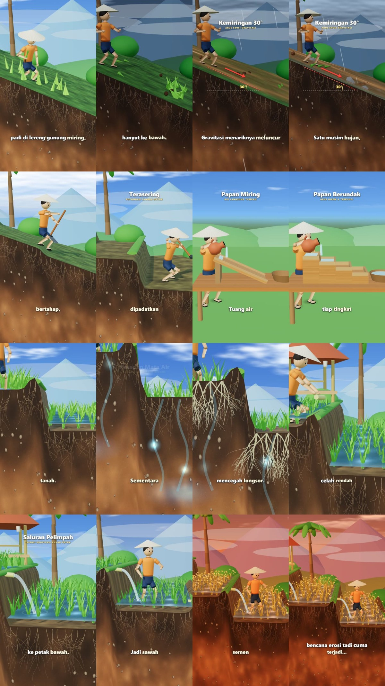 | 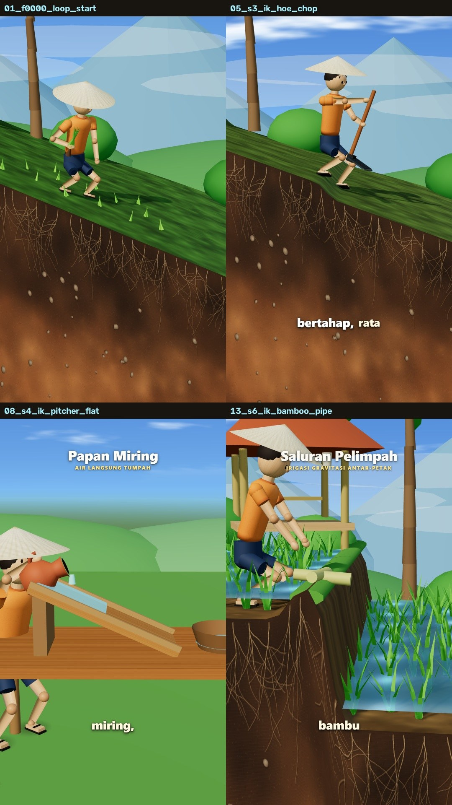 |

---

### 2. `vintage-poster-explainer` — 2D Gouache Travel-Poster & Cross-Section Explainer
- **File Skill**: [`.agents/skills/vintage-poster-explainer/SKILL.md`](./.agents/skills/vintage-poster-explainer/SKILL.md)
- **Ciri Khas**: Reproduksi 1:1 gaya *"Danau Toba Dulunya Gunung Api Raksasa"* — kertas cat air linen statis, lukisan gouache 2–3 nada dengan outline tinta sepia (`#241C1B`), judul `Alfa Slab One` 3D block shadow (`#6E2C1B`), bar karaoke sapuan kuas tinta dengan 3 status warna kata, cutaway stratigrafi geologi, zoom-out peta atlas `d3-geo`, dan penutup kartu pos klasik (*Vintage Travel Postcard*).
- **Golden Reference**: [`remotion/videos/gunung-guntur/`](./remotion/videos/gunung-guntur/) (`npm run render:guntur`) & [`gambut-history/`](./remotion/videos/gambut-history/) (`npm run render:gambut`).

| Gunung Guntur: Raksasa Api Garut | Gambut: Warisan Ribuan Tahun |
|---|---|
| 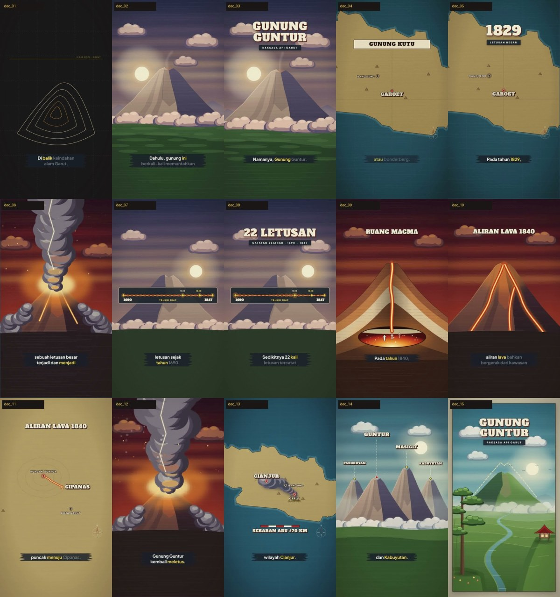 | 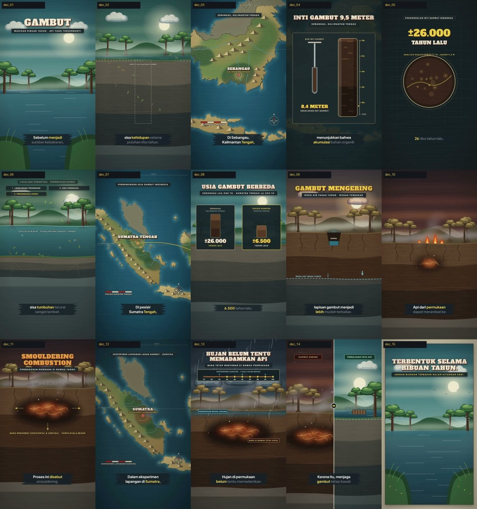 |

---

### 3. `twilight-parchment-docu` — 2D Atmospheric Twilight Parchment Documentary
- **File Skill**: [`.agents/skills/twilight-parchment-docu/SKILL.md`](./.agents/skills/twilight-parchment-docu/SKILL.md)
- **Ciri Khas**: Pencahayaan sinematik plum-indigo ke amber-emas hangat (tanpa `#000`/`#fff` mentah), 5-layer depth parallax, rig karakter 2D SVG berartikulasi dengan *dynamic rim-lighting* dan bayangan api bergetar, header bab serif bercahaya, serta kartu subtitle perkamen sobek (*deckle-edge parchment card*).
- **Golden Reference**: [`remotion/videos/human-fire/`](./remotion/videos/human-fire/) (`npm run render:humanfire`) & [`gmni-history/`](./remotion/videos/gmni-history/) (`npm run render:gmni`).

| Ketika Manusia Mengenal Api | Sejarah Berdirinya GMNI (1954) |
|---|---|
| 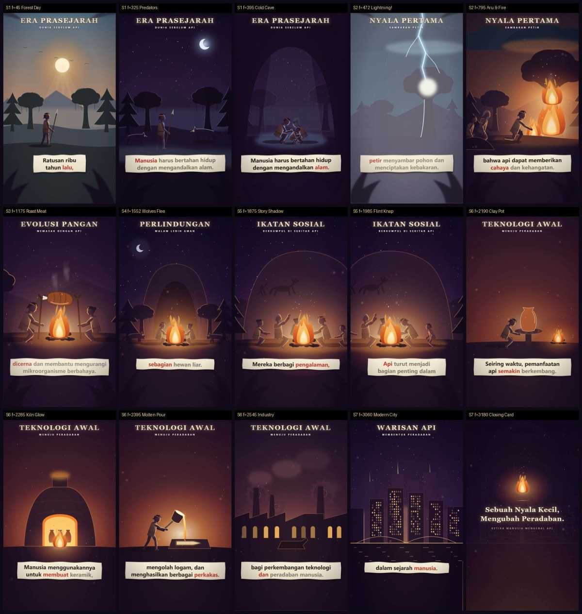 | 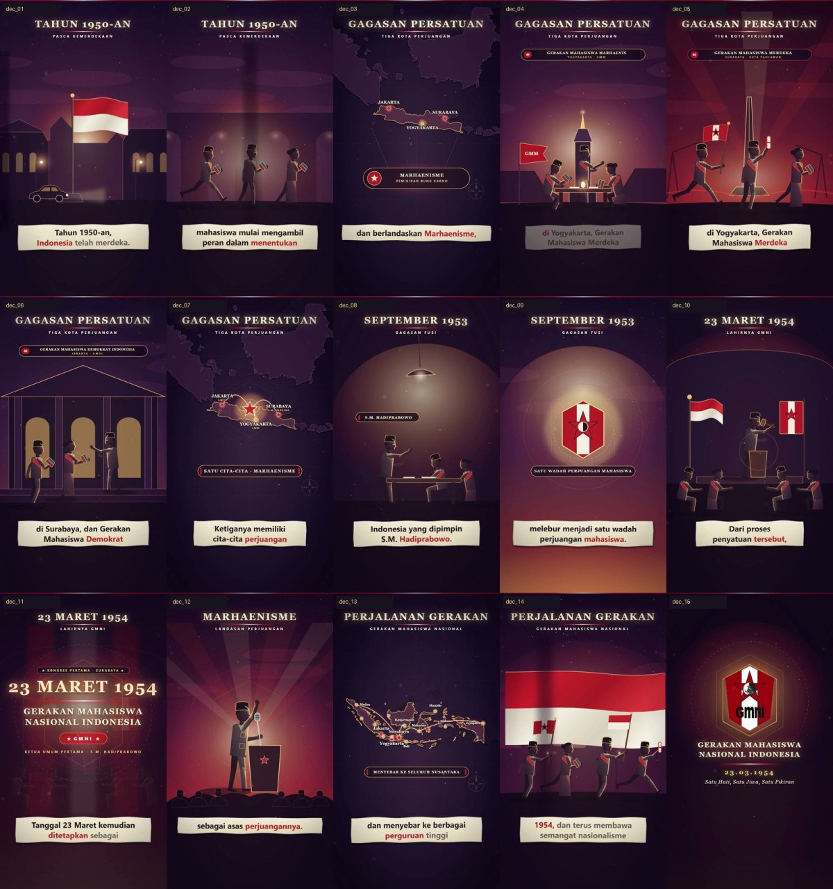 |

---

### 4. `earth-24h-celestial-docu` — 24-Hour Celestial Clock & Deep-Time Evolution
- **File Skill**: [`.agents/skills/earth-24h-celestial-docu/SKILL.md`](./.agents/skills/earth-24h-celestial-docu/SKILL.md)
- **Ciri Khas**: Jam astrolabe kosmik 24 jam dengan busur sektor era yang menyala, transisi kamera menembus pusat jam ke lanskap Bumi purba & Mesozoikum, counter waktu digital real-time, hingga kemunculan peradaban manusia di 3 detik terakhir (`23:59:57`).
- **Golden Reference**: [`remotion/videos/earth-24h/`](./remotion/videos/earth-24h/) (`npm run render:earth24h`).

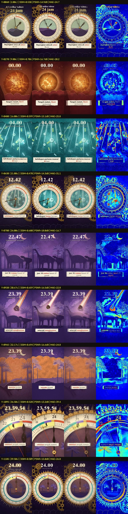

---

### 5. `cosmic-vfx-explainer` — First-Person Astrophysics GLSL Shader & Visor POV
- **File Skill**: [`.agents/skills/cosmic-vfx-explainer/SKILL.md`](./.agents/skills/cosmic-vfx-explainer/SKILL.md)
- **Ciri Khas**: Custom GLSL gravitational lensing & relativistic Doppler accretion disk shader, pantulan lengkung kaca helm astronot (*First-Person Visor POV*), perbandingan 2 jam tangan dilatasi waktu, vektor gaya pasang surut (*spaghettification*), dan telemetri kosmik (`1,5 Rs`, `1,0 Rs`, `∞ Singularitas`).
- **Golden Reference**: [`remotion/videos/black-hole/`](./remotion/videos/black-hole/) (`npm run render:blackhole`) & [`remotion/kurzgesagt/`](./remotion/kurzgesagt/).

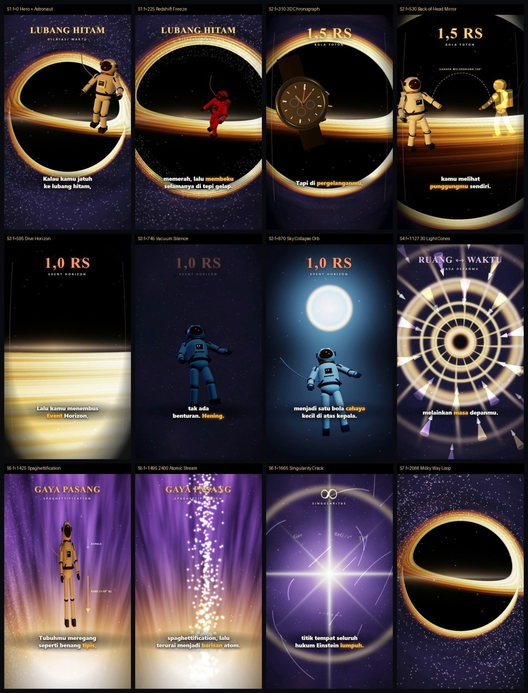

---

### 6. `cartoon-3d-short` — 2D Stickman / Bean-Head Cartoon in a 3D Painted World
- **File Skill**: [`.agents/skills/cartoon-3d-short/SKILL.md`](./.agents/skills/cartoon-3d-short/SKILL.md)
- **Ciri Khas**: Karakter kartun 2D ekspresif ber-outline tinta (`toon.ts`) di dalam kota/dunia 3D penuh warna (`build.ts`, `world.ts`) dengan post-processing outline tinta dunia, depth-of-field, dan skor musik komedi/march.
- **Golden Reference**: [`remotion/videos/bridge/`](./remotion/videos/bridge/), [`remotion/videos/cnut/`](./remotion/videos/cnut/), [`remotion/videos/kakarut/`](./remotion/videos/kakarut/) (`npm run render:kakarut`).

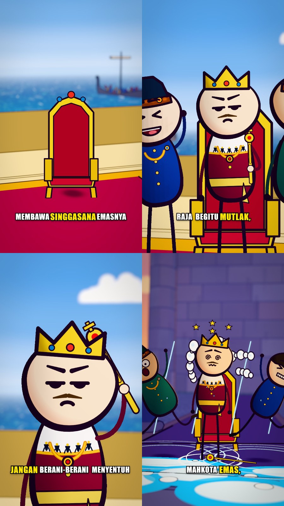

---

### 7. `ipm-premium-documentary-studio` — Editorial Archival Woodcut & Animated Cartography
- **File Skill**: [`.agents/skills/ipm-premium-documentary-studio/SKILL.md`](./.agents/skills/ipm-premium-documentary-studio/SKILL.md)
- **Ciri Khas**: Sistem produksi dokumenter sejarah multi-episode (`1080×1920`) dengan protokol bukti sejarah (`evidence_ledger.csv`), visual ilustrasi arsip gouache/woodcut, dan peta kartografi `d3-geo` Nusantara bergerak.
- **Golden Reference**: [`ipm-chronicles/`](./ipm-chronicles/) (`npm run ipm:render:ep01`) & [`remotion/videos/historical-diorama/`](./remotion/videos/historical-diorama/) (`npm run render:diorama`).

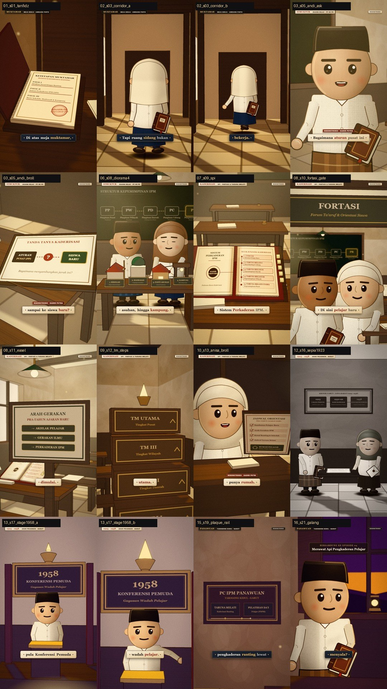

---

### 8. `saas-product-promo` — Commercial SaaS, App & 3D Tech Launch Videos
- **File Skill**: [`.agents/skills/saas-product-promo/SKILL.md`](./.agents/skills/saas-product-promo/SKILL.md)
- **Ciri Khas**: 3 sub-gaya promosi produk digital — (`1`) `explainer-default` (Clean Airy UI Walkthrough), (`2`) `explainer-engaging` (Continuous One-Take Hero Workflow), dan (`3`) `explainer-high-energy` (Beat-Locked 3D Tech Hype Reel).
- **Golden Reference**: [`remotion/compositions/ZAutomationLaunch.tsx`](./remotion/compositions/ZAutomationLaunch.tsx) (`npm run render:reel`) & [`ZAutomationSquarePromo.tsx`](./remotion/compositions/ZAutomationSquarePromo.tsx) (`npm run render:square`).

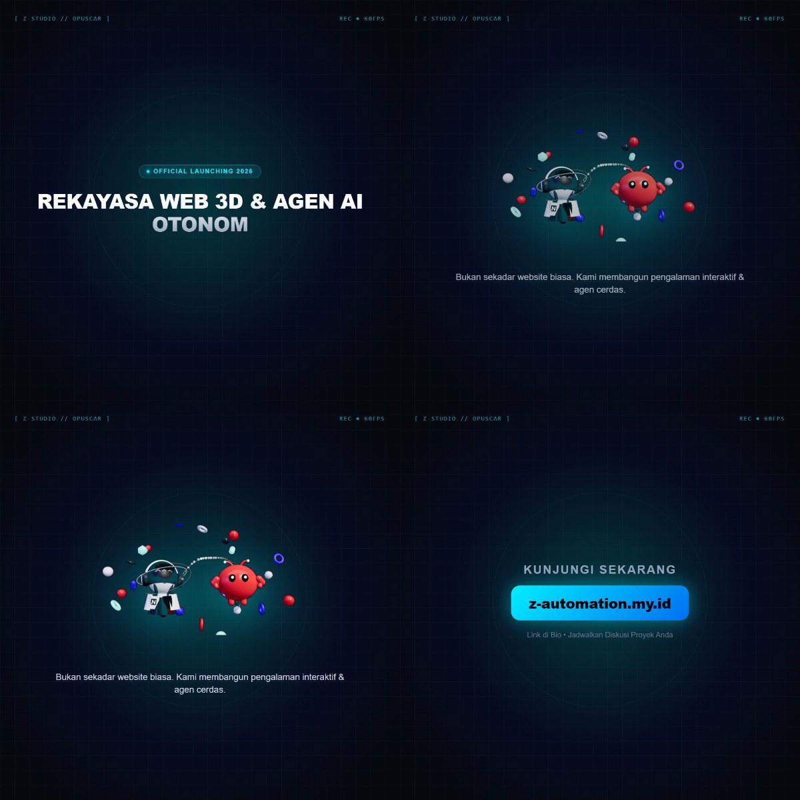

---

## Kompatibilitas Lintas AI Coding Agent

Repository ini dilengkapi file instruksi jembatan sehingga seluruh skill di `.agents/skills/` otomatis dikenali oleh berbagai AI Agent tanpa setup tambahan:

- **Google Antigravity / OpenAI Codex / Gemini CLI / OpenCode**: Membaca [`AGENTS.md`](./AGENTS.md) & [`.agents/skills/`](./.agents/skills/) secara native.
- **Claude Code**: Membaca [`CLAUDE.md`](./CLAUDE.md) → otomatis diarahkan ke `.agents/skills/`.
- **Cursor IDE**: Membaca [`.cursorrules`](./.cursorrules) → otomatis diarahkan ke `.agents/skills/`.
- **Windsurf IDE**: Membaca [`.windsurfrules`](./.windsurfrules) → otomatis diarahkan ke `.agents/skills/`.

---

## Instalasi & Perintah Utama

```bash
# 1. Clone & install dependencies
git clone https://github.com/syntax-slayerrr/z-automation-studio.git
cd z-automation-studio
npm install

# 2. Salin template .env dan masukkan ELEVENLABS_API_KEY
cp .env.example .env

# 3. Jalankan Wizard Pembuat Proyek Video Baru (Ramah Pemula!)
npm run create:video

# 4. Buka Remotion Live Preview Studio di http://localhost:3000
npm run studio

# 5. Verifikasi TypeScript (Wajib 0 Error)
npm run typecheck
```
