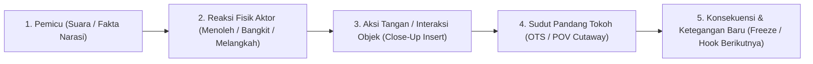

# Laporan Hasil Analisis: Storyboard Berpusat Karakter (*Character-as-Actor*) & Narasi Sinematik

Dokumen ini membedah secara menyeluruh video referensi [media_1794741630097_e4d27a50.mp4](file:///C:/Users/nnnnn/.gemini/antigravity/brain/6a102de0-c5d8-4f8d-890d-eced4b25d061/.user_uploaded/media_1794741630097_e4d27a50.mp4) (`@kelirmalam` — *"Anak Kita · Bagian 1"*, durasi `83.01s`, `1080x1920`, `30 fps`) dari aspek **storyboard, akting karakter (*blocking & performance*), tata kamera, pencahayaan, ritme naskah, serta desain suara**, lalu memetakan perbedaannya dengan pendekatan kita di EP01–EP02 ([Ep02ScenesPartA.tsx](file:///d:/PROJECTS/z-automation-studio/ipm-chronicles/src/episodes/ep02/Ep02ScenesPartA.tsx), [Ep02ScenesPartB.tsx](file:///d:/PROJECTS/z-automation-studio/ipm-chronicles/src/episodes/ep02/Ep02ScenesPartB.tsx), dan [HeritageKid.tsx](file:///d:/PROJECTS/z-automation-studio/ipm-chronicles/src/shared/HeritageKid.tsx)).

> [!IMPORTANT]
> **Temuan Inti:** Kekuatan utama video referensi bukan terletak pada kerumitan animasi anatomi, melainkan pada **kausalitas storyboard di mana karakter menjadi penggerak cerita (aktor)**. Setiap perpindahan gambar (*cut*) terjadi karena **karakter melakukan tindakan fisik, mengarahkan pandangan (*eyeline*), atau berinteraksi dengan objek di ruangannya** — bukan berdiri menghadap kamera sebagai pajangan di bawah teks/grafik.

---

## 1. Peta Visual 1-FPS (`00s – 83s`)

Berikut adalah kontak-frame detik demi detik (`1 fps`) dari seluruh durasi video referensi (`00s–83s`):

````carousel

<!-- slide -->

<!-- slide -->

````

---

## 2. Bedah *Shot-by-Shot* (21 Shot dalam 83 Detik)

Rata-rata durasi per shot adalah **`3.8 detik`**, dengan pergantian skala shot (*Wide → Medium Profile → Close-Up Insert → Over-The-Shoulder → POV Cutaway*) yang menjaga mata penonton terus mengikuti tindakan karakter:

| Shot ID | Detik | Durasi | Ukuran & Sudut Shot | Aksi Karakter & Blocking (*Actor Performance*) | Fungsi Kausalitas Visual | Narasi VO & Efek Suara (SFX) |
|---|---|---|---|---|---|---|
| **SH01** | `00–05s` | `6s` | *Wide Establishing* (Eksterior Malam) | Rumah gelap dengan satu jendela menyala hangat di kanan; kabut bergerak pelan melintasi atap. | Menetapkan dunia cerita dan fokus lokasi (di balik jendela hangat itu ada aturan). | **VO:** *"Di rumah Pak Hadi, ada satu aturan. Kalau Bapak pulang malam..."* + Ambience jangkrik & angin malam. |
| **SH02** | `06–07s` | `2s` | *Medium Interior* (Profil Samping 90°) | Murni berdiri menyamping di dekat lilin lantai, **tangannya mendorong daun jendela kayu hingga terbuka** dan menatap ke luar. | Karakter bertindak sebagai jembatan visual dari dalam rumah menuju objek di luar. | **VO:** *"...lihat tangannya dulu."* + Derit kayu jendela. |
| **SH03** | `08–10s` | `3s` | *Wide Exterior* (Pohon Beringin & Gardu) | Pohon beringin raksasa dengan akar gantung bergoyang pelan di depan cahaya jingga pos ronda. | *Cutaway* dari pandangan jendela ke sumber ancaman masa lalu. | **VO:** *"Dulu, genderuwo dari beringin tua pernah pulang dengan rupa Pak Hadi."* |
| **SH04** | `11–13s` | `3s` | *Medium-Wide Interior* (Profil Kerja) | Pak Hadi **duduk menyamping di kursi kerja**, tubuh sedikit membungkuk, lengan bergerak menulis/meraut di meja di bawah kuda-kuda atap kayu. | Menunjukkan kehidupan sehari-hari tokoh lewat aktivitas tubuh nyata, bukan pose berdiri. | **VO:** *"Bedanya cuma satu."* |
| **SH05** | `14–16s` | `3s` | *Extreme Close-Up Insert* (Siluet Tangan) | **Telapak tangan kiri terangkat** tepat di depan sumber cahaya kuning-jingga; jari kelingking kiri tampak terpotong separuh. | Menanamkan **jangkar visual spesifik** (*visual clue*) yang wajib diingat penonton. | **VO:** *"Kelingking kiri Pak Hadi tinggal separuh."* + Dengung frekuensi rendah. |
| **SH06** | `17–18s` | `2s` | *Medium-Wide Doorway* (Blocking 3 Tokoh) | Di ambang pintu yang terang: Ibu & anak berdiri di kanan menghadap Bapak di kiri yang bersiap turun ke halaman membawa senter/pentungan. | Membangun relasi antar-tokoh lewat posisi berdiri (*staging* berhadapan di ambang pintu). | **Dialog Bapak:** *"Bapak ronda dulu. Kunci pintunya, Bu."* |
| **SH07** | `19–21s` | `3s` | *Close-Up Macro Insert* (Palang Pintu) | **Tangan menggeser palang kayu pengunci pintu** masuk ke dudukannya sampai mentok. | Membuktikan secara visual bahwa pintu sudah terkunci rapat dari dalam. | **Dialog Bapak:** *"Jaga Ibu, Le."* + **SFX:** Gesekan kayu & bunyi *klok* palang mengunci. |
| **SH08** | `22–26s` | `5s` | *Medium-Wide Low Angle* (Duduk di Lantai) | Murni duduk bersimpuh menyamping di lantai dekat lilin. Saat ketukan terdengar (`24s`), **kepala dan bahunya tersentak tegak menoleh ke arah pintu kiri**. | **Akting reaksi (*trigger → reaction*)**: ketukan suara memicu perubahan postur tubuh karakter. | **SFX:** *Tok.. tok.. tok* (pelan). **VO:** *"Belum tengah malam, pintu depan diketuk. Pelan."* |
| **SH09** | `27–28s` | `2s` | *Medium-Wide Cutaway* (Atap Genteng) | Sudut miring atap genteng di bawah kabut bulan; hening, tidak ada benda jatuh. | Memvisualisasikan pemeriksaan indra pendengaran tokoh dari dalam rumah. | **VO:** *"Tidak ada kerikil di genteng."* |
| **SH10** | `29–30s` | `2s` | *Medium Interior Cutaway* (Sudut Meja Gelap) | Sudut ruangan dan jendela yang remang dan tenang. | Memvisualisasikan pemeriksaan indra penciuman tokoh; membangun jeda tegang. | **VO:** *"Tidak ada bau apa-apa."* |
| **SH11** | `31–33s` | `3s` | *Medium Close-Up* (Pintu Tertutup) | Kamera menghadap tegak lurus ke daun pintu kayu yang tertutup rapat; celah bawah pintu memantulkan cahaya lilin saat suara dari luar memanggil. | Menempatkan penonton tepat di posisi Murni yang sedang menatap pintu. | **Dialog Luar:** *"Bu, Bapak pulang."* |
| **SH12** | `34–38s` | `5s` | *Medium Tracking* (Berjalan & Menyibak Tirai) | Siluet Murni **bergerak mendekati jendela**, lalu **tangannya terangkat menyibak kain gorden gelap ke samping** hingga pagar luar terlihat. | Karakter melakukan aksi verifikasi aturan pertama (mengintip sebelum membuka). | **VO:** *"Murni tidak langsung membuka. Ia mengintip dari jendela, seperti biasa."* |
| **SH13** | `39–42s` | `4s` | *POV Over-Curtain* (Jendela ke Luar) | Dari balik bukaan gorden: pagar luar diterangi cahaya bulan biru-kelabu, lalu **sebuah tangan muncul dari bawah dan menempel ke kaca**. | **Shot POV (Sudut Pandang Karakter)**: penonton melihat persis apa yang dilihat Murni. | **VO:** *"Tangan itu terangkat pelan ke kaca, di depan cahaya bulan."* |
| **SH14** | `43–45s` | `3s` | *Extreme Close-Up POV* (Tangan di Kaca) | *Cut-in* lebih dekat ke siluet telapak tangan di kaca berlatar pagar malam: **kelingking kirinya tinggal separuh**. | Membayar *visual clue* dari SH05; meyakinkan karakter untuk bertindak membuka pintu. | **VO:** *"Kelingking kirinya... tinggal separuh."* (diucapkan setengah berbisik). |
| **SH15** | `46–48s` | `3s` | *Medium-Wide Doorway* (Membuka Pintu) | Murni di kiri **menarik daun pintu terbuka**; sosok tinggi bersiluet Bapak melangkah masuk melewati ambang pintu berhadapan dengannya. | Konsekuensi langsung dari verifikasi di SH14. | **VO:** *"Murni membuka pintu."* + **SFX:** Derit pintu terbuka. |
| **SH16** | `49–51s` | `3s` | *Close-Up Insert → Blackout* (Lilin Padam) | Fokus dekat pada nyala lilin di lantai yang bergoyang lalu **padam total menjadi layar hitam pekat (`50–51s`)**. | Transisi elipsis waktu yang dramatis tanpa perlu menampilkan adegan malamnya. | **VO:** *"Lalu lampu ruang depan padam."* + Hembusan napas/angin & hening gelap. |
| **SH17** | `52–56s` | `5s` | *Wide Exterior* (Ronda Subuh Melintas) | Kabut subuh biru-dingin; **3 warga ronda berjalan dari kiri ke kanan** memukul kentongan di jalan depan rumah. | Menandai pergantian waktu ke subuh lewat pergerakan tokoh latar (*background actors*). | **SFX:** Kentongan ronda *통-통-통*. **VO:** *"Menjelang subuh, kentongan ronda lewat di jalan depan."* |
| **SH18** | `57–58s` | `2s` | *Close-Up Insert* (Kepalan Tangan Mengetuk) | Siluet lengan dan **kepalan tangan menghantam daun pintu berulang kali dengan cepat**. | Kontras visual dan ritme terhadap ketukan pelan di SH08; memicu *twist*. | **VO:** *"Lalu pintu diketuk lagi. Keras."* + **SFX:** Gedoran pintu keras. |
| **SH19** | `59–63s` | `5s` | *Over-The-Shoulder / OTS* (Bapak Asli di Pintu) | **Bahu & kepala Murni buram di foreground kiri bawah**; di ambang pintu depan yang terbuka berdiri Bapak asli kebingungan. Di `62s`, **kepala Murni di foreground menoleh ke arah dalam rumah**. | Framing **OTS sinematik**: menyatukan reaksi tokoh di depan kamera dengan pemicu di latar, lalu *head-turn* memotivasi *cut* berikutnya. | **Dialog Bapak:** *"Bu? Kok pintunya nggak dikunci?"* **VO:** *"Murni menoleh ke dalam."* |
| **SH20** | `64–71s` | `8s` | *2x POV Cutaway* (Kasur Hangat → Pintu Dapur) | **Cut 1 (`64–67s`):** Kasur lantai yang baru ditinggalkan di bawah berkas cahaya subuh. **Cut 2 (`68–71s`):** Lorong menuju pintu dapur yang terbuka dengan kepulan tipis. | Mengikuti arah tolehan kepala Murni di SH19; memberi 2 bukti indrawi tanpa penjelasan berlebih. | **VO:** *"Kasurnya masih hangat. Dan dari dapur... bau singkong bakar."* |
| **SH21** | `72–83s` | `11s` | *Medium Close-Up Profile* → *End Card* | Murni berdiri **membeku dalam siluet profil samping** di lorong rumah (`72–75s`), lalu masuk ke kartu hitam **`Bersambung — Bagian 2: Singkong Bakar`**. | Menutup episode pada puncak ketegangan emosional (*emotional freeze*) yang memaksa penonton lanjut ke bagian berikutnya. | **VO:** *"Murni tidak menjawab."* + Dentum rendah menggantung. |

---

## 3. Lima Prinsip Utama yang Membuat Karakter Menjadi "Aktor Kunci"



### A. Orientasi Tubuh Asimetris (*Profile, 3/4, & Over-The-Shoulder*)
Di EP01–EP02 kita, karakter hampir selalu berdiri simetris menghadap kamera (`0° front view`). Dalam sinema dan video referensi ini:
- **90% shot karakter menggunakan sudut Samping (`90° Profile`), Tiga-Perempat (`45°`), atau Dari Belakang Bahu (`Over-The-Shoulder / OTS`)**.
- Karakter menghadap ke **objek di dalam adegan** (jendela, meja tulis, pintu, lawan bicara), bukan menghadap penonton. Hal ini langsung mengubah status karakter dari "maskot presentasi" menjadi **manusia yang hidup di dalam ruang sejarah tersebut**.

### B. *Cut on Action* & Motivasi Pandangan (*Eyeline Match*)
Potongan antar-shot di video referensi mengikuti hukum *Hollywood Storyboard Editing*:
1. **Aksi → Insert Detail:** Karakter berjalan ke pintu (Medium) → *Cut* ke tangan menggeser palang kunci (Close-Up Insert).
2. **Tolehan Kepala → POV (Apa yang Dilihat):** Karakter di SH19 menoleh ke dalam (`Murni menoleh ke dalam`) → *Cut* langsung ke SH20 (kasur dan dapur yang dilihat Murni).

### C. Keberanian Menggunakan *Close-Up Insert* Tangan & Objek
Sebanyak **6 dari 21 shot (`~28%`)** adalah *Close-Up / Macro Insert* pada tangan atau objek kunci:
- Telapak tangan di depan cahaya (`SH05` & `SH14`),
- Tangan menggeser palang pintu kayu (`SH07`),
- Tangan menyibak gorden jendela (`SH12`),
- Nyala lilin yang padam (`SH16`),
- Tangan menggedor pintu (`SH18`).
Di `ipm-chronicles`, teknik ini sangat cocok untuk menampilkan **tangan pelajar menulis konsep di buku catatan, menggeser papan pengumuman ranting, memegang lencana/pedoman IPM di depan cahaya jendela, atau mengetuk palu sidang**.

### D. Tata Cahaya Kontras Tinggi (*Chiaroscuro* & *Rim Silhouette*)
- Video referensi memisahkan ruang dengan **dua suhu warna yang bertabrakan**: ruang dalam hangat (`#f59e0b` / *candlelight amber*) vs ruang luar dingin berkabut (`#64748b` / *moonlit slate*).
- Karakter sering dirender sebagai **siluet gelap pekat dengan garis cahaya tepi (*rim light*) tipis**, sehingga gerakan sekecil apa pun (menoleh, mengangkat tangan, menunduk) terbaca sangat tegas dan dramatis di layar vertikal ponsel.

### E. Narasi "Show, Don't Preach" & Jeda Sunyi Bermakna
- Kalimat sangat hemat (**rata-rata 4–7 kata per kalimat**), konkret, dan bertumpu pada benda/pancaindra (*tangannya, kelingking kiri, kerikil di genteng, kasurnya masih hangat, bau singkong bakar*).
- Setiap ada aksi fisik penting (mengunci pintu, mengintip jendela, lampu padam, menoleh ke dapur), **narator berhenti bicara selama `0.6s – 1.5s`** dan membiarkan **suara foley nyata + gerakan karakter** berbicara sendiri.

---

## 4. Matriks Perbandingan: EP02 Saat Ini vs Target EP03 (*Actor-Driven Storyboard*)

| Aspek Produksi | EP01 & EP02 Saat Ini | Target EP03 (Adaptasi Gaya Referensi ke Sejarah IPM) |
|---|---|---|
| **Struktur Adegan** | `1 Scene = 1 Panggung Statis` berdurasi `18–28 detik` (kamera hanya zoom pelan). | `1 Scene = 3–5 Shot Sinematik` (`3–6 detik` per shot: *Establishing → Actor Profile Action → Hand/Object Insert → OTS/POV → Reaction*). |
| **Peran `HeritageKid`** | Berdiri berjajar di bawah layar menghadap depan (`front-facing`), mengangguk/kaget saat kartu muncul. | Menjadi **subjek utama di tengah komposisi**: duduk menulis di meja dalam profil samping, membuka pintu kelas, berjalan menyusuri koridor, menoleh saat ada ketukan/keputusan, berdiri di *foreground OTS*. |
| **Tampilan Dokumen & Fakta Sejarah** | Kartu plakat melayang di udara di atas kepala karakter. | Dokumen/buku/papan tulis **dipegang, ditulis, dibuka, atau dilihat langsung oleh karakter** (melalui *Close-Up Hand Insert* atau *Over-The-Shoulder shot* ke papan tulis/meja). |
| **Gaya Narasi & VO** | Kalimat informatif-historis (`10–18 kata`) yang merangkum banyak peristiwa sekaligus. | Kalimat pendek bergaya pencerita intim (`4–9 kata`), membuka *curiosity gap* lewat satu objek/aturan nyata, memberi jeda sunyi untuk foley & akting karakter, tetap **100% patuh fakta sejarah (`evidence_ledger.csv`) tanpa mengarang dialog fiktif**. |
